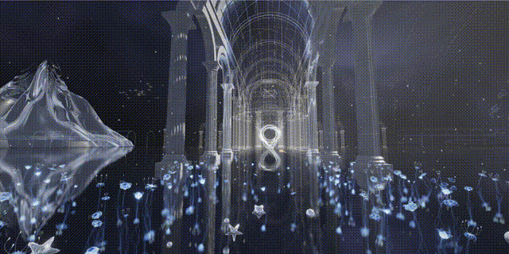

# Axis

一个主要由 **Fable 5.2** 通过程序化建模生成的单文件 WebGL2 3D 场景实验。  
不依赖 three.js 等 3D 引擎库，探索前沿大模型在「纯代码画场景」上的能力边界。

> **在线体验**：[https://qssainner.github.io/Axis/](https://qssainner.github.io/Axis/)  

---

## 操作方式

- **移动**：`W A S D` 或方向键（按住 `Shift` 奔跑）
- **视角**：点击画面后移动鼠标环顾（按 `Esc` 释放鼠标）
- **触屏**：左半屏移动，右半屏环顾
- 建议使用桌面端浏览器打开以获得最佳帧率与清晰度。

---

## 授权说明

本项目的内容分为两部分，适用不同的授权：

| 内容 | 授权 |
|---|---|
| 源代码（几何生成、着色器、渲染逻辑等） | [MIT License](./LICENSE)，可自由使用、修改与再分发，需保留版权声明 |
| 世界观设定与概念表现 | 版权归 B 站 VTuber **LockeLanphier** 所有，**不在本项目授权范围内**，使用请联系原作者 |

如需复用本项目的渲染逻辑，需替换为你自己的世界观与美术内容。

